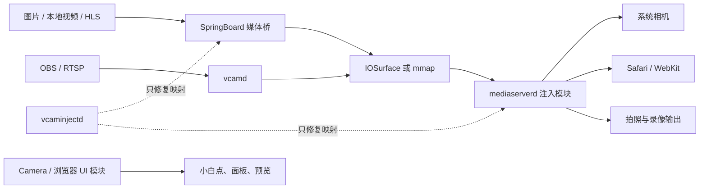

# VCAM 框架与功能分析（小白学习版）

> 适用项目：`IOSVCAN-DS/vcam`  
> 文档基准：`0.8.82+ios16-stream-stability`
> 部署目标：越狱环境下的 iOS 16.0–16.5（不包含 iOS 15，也不承诺 iOS 16.6 及以上）

最新固定提交、CI run、DEB 哈希和设备证据见 [`CURRENT-RELEASE-STATUS-ZH.md`](CURRENT-RELEASE-STATUS-ZH.md)。

## 1. 先用一句话理解项目

VCAM 是一个“系统级虚拟相机桥接器”：它把图片、本地视频、OBS、RTSP 或 HLS 产生的视频帧送进 iPhone 的相机数据链路，让系统相机和网页相机看到虚拟画面，而不是直接改网页、相机 App 或认证业务的判断逻辑。

可以把它想成一套电视直播系统：

- 图片、视频、RTSP、HLS 是不同的节目源；
- SpringBoard 或 `vcamd` 是节目制作间，负责解码并准备画面；
- IOSurface 是高速传送带；
- `mediaserverd` 是总播控室，把画面交给相机和浏览器；
- 小白点和控制面板只是遥控器，不负责真正替换相机画面。

## 2. 项目明确做什么、不做什么

### 2.1 做什么

- 在系统相机预览、Safari/WebKit、拍照和录像输出边界替换视频帧；
- 支持静态图片、本地视频、OBS、RTSP、HLS 五类来源；
- 在相机和支持的浏览器中显示一个可拖动小白点与控制面板；
- 通过共享内存和 IOSurface 在进程之间传递原始 BGRA/NV12 像素；
- 虚拟源断开时保持最后一张虚拟帧、输出黑帧或停止该路样本，不能偷偷回到真实相机；
- 保留真实麦克风，当前不替换音频。

### 2.2 不做什么

- 不 Hook 身份识别、活体、KYC、支付或认证结果；
- 不修改网站的 JavaScript，也不伪造网页业务返回值；
- 不让 Camera、Safari、Chrome 等 App 进程直接替换相机帧；
- 不把 JPEG、H.264、HEVC 压缩码流直接交给 `mediaserverd`；
- 不保证 WSL 产物可以作为正式 arm64e 发布包；
- 没有独立的“硬盘 SMART/坏道监测”功能。项目会限制导入文件为 2 GiB、预留至少 256 MiB 空间、只保留当前与上一份媒体，并把诊断日志限制为 4 MiB；这些是逻辑存储保护，不是硬件健康检测。

## 3. 四个运行组件



### 3.1 `VCAMMediaServerClient.dylib`

加载位置只有 `mediaserverd`，是最关键的相机帧替换模块。

它的工作很克制：

1. 读取最新的原始共享帧；
2. 判断当前 `BWNodeOutput` 是否为允许替换的相机输出节点；
3. 按目标缓冲区的尺寸和像素格式绘制虚拟帧；
4. 把结果送给 Camera、WebKit、拍照或录像链路。

它故意不包含网络、FFmpeg、AVPlayer、相册选择器和控制 UI。这样可以减少 `mediaserverd` 崩溃风险，也避免某个网络源卡住整个系统相机服务。

正式编译入口：

- `Sources/Hooks/VCAMMediaServerRefEntry.xm`
- `Sources/Hooks/VCAMMediaServerRefImageUtils.m`

提示：`Sources/Hooks` 目录里还有历史或诊断文件。判断哪个文件真正参与正式包，要看项目根目录的 `Makefile`，不能只看文件是否存在。

### 3.2 `VCAMSpringBoardClient.dylib`

这个动态库有两种角色：

- 在 SpringBoard 中：运行配置 Broker、静态图片发布器、本地视频/HLS 的原生播放器；
- 在 Camera 和浏览器主进程中：只显示小白点、控制面板和预览，不 Hook 相机帧。

当前过滤的 UI 目标包括：

- SpringBoard；
- 系统相机；
- Safari；
- Chrome iOS；
- Microsoft Edge iOS；
- Firefox iOS。

过滤名单只说明“代码允许加载”，不等于这些浏览器都已经在当前测试机上逐一验收。

### 3.3 `vcamd`

`vcamd` 是 LaunchDaemon，不是注入动态库。当前 plist 将它以 `mobile` 用户运行。

正式职责：

- 接收并解码 OBS JPEG 帧；
- RTSP 的 FFmpeg 解复用、RTP/H.264 处理和解码；
- 发布最新的 IOSurface；
- 作为 IOSurface 权限中继服务，但不复制帧数据。

本地图片、本地视频和 HLS 在 `vcamd` 中只保留显式回滚路径，正常生产路径由 SpringBoard 负责。

### 3.4 `vcaminjectd`

`vcaminjectd` 是以 root 运行的小型守护进程。它只在 SpringBoard 或 `mediaserverd` PID 变化后修复这两个目标的动态库映射，不解码、不发布视频，也不向应用进程注入相机替换逻辑。

## 4. 一帧画面到底怎样走到网页

以“相册里选一个本地视频，然后 Safari 调用相机”为例：

1. 用户点击小白点，打开控制面板；
2. 选择相册视频，原始文件被复制到 `/var/mobile/Media/VCAM`；
3. 配置写入 `/var/mobile/Media/VCAM/com.codex.vcam.plist`；
4. SpringBoard 收到配置变更通知；
5. `AVPlayer` 解码视频；
6. `AVPlayerItemVideoOutput` 取得 NV12 `CVPixelBuffer`；
7. Core Image/Metal 一次完成视频自带方向和用户设置的旋转、镜像；
8. 画面写入源尺寸、三槽的 IOSurface；
9. `mediaserverd` 读取最新槽位；
10. Safari 仍用真实相机图来协商 480p、720p 或 1080p 等目标格式；
11. VCAM 只把虚拟像素一次性中心裁剪并填满这个已协商目标；
12. WebKit 收到尺寸、像素格式、时序和附件均来自原相机链路的样本，只是像素内容被替换。

这就是“物理相机图负责协商，VCAM 负责换像素”的含义。

## 5. 五类媒体源

| 来源 | 正式生产进程 | 解码/读取方式 | 共享像素 | 槽数 |
|---|---|---|---|---:|
| 静态图片 | SpringBoard | ImageIO | 源尺寸 BGRA | 1 |
| 本地视频 | SpringBoard | AVPlayer + AVPlayerItemVideoOutput | 源尺寸 420v/NV12 | 3 |
| HLS | SpringBoard | AVPlayer + AVPlayerItemVideoOutput | 源尺寸 420v/NV12 | 3 |
| OBS | `vcamd` | LAN WebSocket JPEG | 源尺寸 BGRA | 3 |
| RTSP | `vcamd` | FFmpeg 纯软件解码 | NV12；有旋转时为 BGRA | 3 |

### 5.1 静态图片

相册或文件选择器会尽量保留原始文件字节和扩展名。SpringBoard 用 ImageIO 读取 JPEG、PNG、HEIC/HEIF 的方向信息，生成一张源尺寸 BGRA IOSurface。

静态图片只有一帧，不需要生产者不断改写不同槽位，因此单槽最简单，也不会因为只有一槽而降低清晰度。

### 5.2 本地视频

MOV、MP4、M4V 走 Apple 原生 `AVPlayer`。视频轨道的 `preferredTransform` 只应用一次，之后共享帧就是项目内部统一的正向基准。视频结束后可按配置循环，不会把整段视频预解码到内存。

### 5.3 HLS

HLS 同样走 Apple 原生 `AVPlayer`，由系统处理分片、缓冲和时间线。项目无法通过 iOS 16 公共 API 证明某一次播放实际使用了哪类解码器，因此界面只显示“系统原生播放”。项目设置较小的前向缓冲，只记录直播边缘延迟，不再定时 seek 刷新正常播放队列；连续八秒没有解码帧时才重建会话。

注意：使用了原生管线不等于已经证明所有 HLS 服务端都低延迟、无卡顿。服务端时间戳、分片长度、实际发布帧率和手机端渲染都需要共同验收。

### 5.4 OBS

电脑端 `desktop/obs_bridge.py` 把 OBS 画面以 JPEG 帧发送到局域网，`vcamd` 解码成 BGRA 并发布。这个方案简单，适合可信局域网，但 JPEG 编解码和网络仍会增加负担。

### 5.5 RTSP

RTSP 使用 FFmpeg 处理 RTSP/RTP、H.264 参数集、NAL、时间戳和重排序，并在 iOS 16.0-16.5 上固定使用软件解码。无额外旋转/镜像时，8 位 NV12/YUV420 可以直接进入三槽 IOSurface，减少 BGRA 转换。

此前 direct-VT、FFmpeg VideoToolbox 和 GStreamer `vtdec_hw` 探针都没有在目标真机连续取得非空硬件帧；软件解码反而能出帧。继续保留硬解选择器还会污染软件 codec context，造成连接成功却不出帧，因此这些 RTSP 硬解正式分支已经删除。必须区分两个概念：

- 成功连接 RTSP：只证明网络和协议握手成功；
- 连续收到非空 `CVPixelBuffer` 并在屏幕上稳定显示：才证明解码链路真正工作。

当前 RTSP 真机重点验收项是软件解码后的连续非空帧、IOSurface 序号持续推进，以及长时间播放不冻结；不再把硬件解码列为交付目标。

## 6. 为什么图片用 1 缓冲，视频用 3 缓冲

缓冲区可以理解为画家和观众之间的画板。

### 静态图片：一块画板就够

图片写入一次后不再改变。观众读取多久都不会与下一帧冲突，因此一槽即可。

### 视频：三块画板更稳

视频每秒可能产生 24、30 或 60 帧：

- A 槽正在被 `mediaserverd` 读取；
- B 槽放着上一张完整帧；
- 生产者可以向 C 槽写下一帧。

写完后才原子地公布“最新槽位”。消费者持有某槽时，生产者不能覆盖它。三槽不是保存三份完整视频，也不会让画质下降；它只是避免读写同一内存导致撕裂、花屏和卡顿。

## 7. IOSurface、mmap 和 Broker 是什么

### 7.1 IOSurface

IOSurface 是 Apple 提供的跨进程图像共享机制。不同进程可以引用同一块 GPU/图像内存，不必每帧通过 Socket 复制几 MB 数据。

当前正式帧通路优先使用源尺寸 IOSurface：

- 图片：一槽 BGRA；
- 本地视频/HLS：三槽 NV12；
- OBS：三槽 BGRA；
- RTSP：三槽 NV12 或变换后的 BGRA。

### 7.2 Broker

Broker 只传 IOSurface 权限和少量元数据，不传整帧像素。配置请求必须先通过 XPC 审核进程身份并取得 10 秒有效、单次使用的随机令牌；项目不再内置固定口令。媒体路径还必须解析后位于 `/var/mobile/Media/VCAM`，Broker 不提供任意文件读取命令。

### 7.3 mmap 兼容通路

项目还保留固定 1080×1920、三槽 BGRA 的 mmap，主要用于 IOSurface 权限握手前的兼容启动和显式旧解码器回滚。正常握手完成后，不能无限使用旧 mmap 帧代替新的 IOSurface 数据。

共享元数据包含：

- 帧序号；
- 单调时钟时间戳；
- 宽和高；
- 像素格式；
- IOSurface ID；
- 生产者 generation（代次）。

generation 用来区分“同一个三槽环中的 A/B/C 槽”和“切换来源后全新的一组三槽”，从而避免快速切源时闪回旧画面。

## 8. 分辨率、比例和方向

这是项目最容易误解的部分。

### 8.1 源尺寸不等于浏览器最终尺寸

例如相册视频是 2160×3840，VCAM 可以用源尺寸共享，但 Safari 可能只请求 640×480。最终一定要把源画面合成到 Safari 已协商的 640×480 缓冲区。

### 8.2 为什么不能强制浏览器永远输出 640×480

真实 iPhone 相机会暴露多个档位。网页可能请求 480p、720p 或 1080p，WebKit 再从真实相机能力中选择一个实际档位。VCAM 保留这套真实协商外壳，不伪造固定能力表，也不在会话中擅自改变宽高、帧率或像素格式。

### 8.3 当前浏览器合成策略

对已验证的 iOS 16 WebKit 视频转换终端：

1. 竖向源先转换到 WebKit 使用的横向存储基准；
2. 按目标宽高比做一次中心裁剪；
3. 一次缩放并填满已经协商的目标缓冲区；
4. 不拉伸，不加黑边，也不再做第二次 VCAM 放大。

页面自己的 CSS（例如 `object-fit: cover`）仍可能再裁掉边缘，但那属于网页布局，不是 VCAM 再次修改相机分辨率。

### 8.4 为什么 9:16 进入 3:4 会裁边

“完整显示、无裁切”和“填满、无黑边”不能同时满足不同宽高比。当前浏览器方案选择接近真实相机的 `center-crop/fill`：保持比例、不拉伸、填满目标，因此必然裁掉部分上下或左右内容。

### 8.5 四条方向路径

- 控制面板预览：直接显示统一后的共享帧，不再额外旋转；
- Camera 预览：沿用相机目标，采用完整画面适配策略；
- WebKit：只在已确认的视频转换终端使用其存储基准补偿和中心填满；
- 拍照：VCAM 只按系统已协商的目标做等比裁剪/缩放，不按手机或源姿态旋转像素，也不改写系统 sample 的方向 metadata；保存方向和比例由系统相机图负责。

方向不能只靠“宽大于高”猜测。图片 EXIF、视频 `preferredTransform`、目标节点语义和像素缓冲的实际存储方向必须分别处理。

## 9. 小白点、控制面板和预览

小白点是独立 UI，不是相机替换开关本体。

当前行为：

- 单击：打开来源/控制面板；
- 拖动：保存位置；
- 单指双击或三指双击：切换小白点显示状态；
- 小白点附带状态指示器；
- 静态图片显示“已加载静态图片”，不显示虚假的 FPS；
- 视频状态使用共享帧时间戳估算实际 FPS，不应固定写死 30；
- SpringBoard 与前台 Camera/浏览器通过前台所有权协调，避免同时出现两个点；
- App 沙箱无法读取原始共享帧时，可向 SpringBoard 请求缩小 JPEG，仅用于面板预览。

JPEG 预览不会送进 `mediaserverd`，因此不会降低真正相机替换画面的质量。

## 10. 拍照与录像

### 10.1 拍照

静态拍照终端会把虚拟像素写进照片路径，并保留系统照片流程需要的元数据。目标是：

- 相机预览方向、悬浮预览方向、浏览器方向和保存照片方向一致；
- 保存宽高比跟随所选源和目标相机链路，不因手机横放而无条件旋转；
- 不在进入 `mediaserverd` 前把源图片压缩成 JPEG 预览图。

“保存照片为 3:4 还是 4:3”不仅取决于源图，还取决于系统静态照片终端采用的像素存储宽高和 EXIF。这个功能需要在真机相册里同时核对显示方向、实际像素尺寸和 EXIF，不能只看 Camera 缩略图。

### 10.2 录像

录像输出可能使用设备私有压缩格式。项目会建立同目标尺寸的公开 `420v` 中间缓冲，再用 VideoToolbox 像素传输写回私有格式副本；时间戳重排和最终编码仍交给系统编码器。

拍照或录像时，虚拟模式不能因为节点切换而泄露真实相机帧。

## 11. 安全与故障策略

当用户已经开启虚拟模式时，系统采用 fail-closed 策略：

- 有新虚拟帧：显示新帧；
- 短暂断流：尽量保持最后一张虚拟帧；
- 没有可安全复用的帧：显示黑帧或抑制该样本；
- 只有用户明确点击恢复真实相机，才重新输出真实相机。

这样做会让故障更明显，但可避免网络断开时意外显示真实环境。

## 12. 配置、媒体与日志位置

| 内容 | 设备路径 |
|---|---|
| 主配置 | `/var/mobile/Media/VCAM/com.codex.vcam.plist` |
| 导入媒体目录 | `/var/mobile/Media/VCAM` |
| 应用/桥接日志 | `/var/mobile/Media/VCAM/vcam-app.log` |
| Broker 诊断日志 | `/var/mobile/Media/VCAM/broker-probe.log` |
| `vcamd` 标准输出 | `/var/tmp/vcamd.log` |
| `vcaminjectd` 日志 | `/var/tmp/vcaminjectd.log` |
| mmap 共享帧 | `/var/tmp/com.codex.vcam.frames` |
| HLS 旧路径回滚开关 | `/var/tmp/vcam-hls-legacy-vcamd.enable` |
| 本地视频旧路径回滚开关 | `/var/tmp/vcam-local-video-legacy-vcamd.enable` |
| 静态图片旧路径回滚开关 | `/var/tmp/vcam-local-image-legacy-vcamd.enable` |

导入媒体采用有界保留策略：单个导入文件最多 2 GiB，并要求至少保留 256 MiB 可用空间；当前文件之外只保留最新的一个前任导入文件。源尺寸静态 BGRA 解码最多使用 64 MiB，超过时明确拒绝而不是偷偷降画质。诊断日志最多 4 MiB。这些措施避免目录和内存无界增长，但不是 iOS 存储硬件故障监测。

## 13. 源码目录怎么读

```text
Sources/
├─ Core/          配置、渲染、注入策略和公共协议
├─ Daemon/        vcamd 主循环、帧生产、硬解、Broker、注入监控
├─ Hooks/         mediaserverd 与 SpringBoard 的实际 Hook 入口
├─ Shared/        mmap、IOSurface、槽位、原子元数据协议
├─ Sources/       本地媒体、OBS、RTSP 来源实现
├─ SpringBoard/   图片、本地视频、HLS 的原生媒体桥
├─ UI/            小白点、控制面板、媒体选择器、悬浮预览
└─ Probes/        诊断探针，不是正式主路径
```

推荐阅读顺序：

1. `README.md`：先了解产品边界；
2. `ARCHITECTURE.md`：了解正式数据链；
3. `Makefile`：确认哪些源码真正参与编译；
4. `Sources/Core/VCAMConfiguration.h`：认识来源种类和配置字段；
5. `Sources/Shared/VCAMSharedFrame.h`：认识共享帧协议；
6. `Sources/SpringBoard/VCAMSpringBoardMediaBridge.m`：看图片、本地视频、HLS；
7. `Sources/Daemon/VCAMFrameProducer.m`：看 OBS、RTSP 和回滚路由；
8. `Sources/Hooks/VCAMMediaServerRefEntry.xm`：看哪些相机节点会替换；
9. `Sources/Hooks/VCAMMediaServerRefImageUtils.m`：看像素如何画进目标；
10. `Sources/UI/VCAMMediaPickerController.m`：看小白点和来源选择。

## 14. 构建、CI 和安装

项目同时编译 arm64 和 arm64e，最低 SDK 目标为 iOS 16.0。

### 14.1 WSL 本地编译

```bash
cd /mnt/d/work/IOSVCAN-DS/vcam
bash ./scripts/build-rootless-wsl.sh
```

WSL 脚本使用 `/opt/theos` 和 iPhoneOS 16.5 SDK，产物放到 `dist/wsl-rootless`。它适合快速发现 Objective-C、链接和打包错误。

### 14.2 为什么正式发布要走 macOS CI

Linux Theos 工具链可以编出 arm64e 切片，但当前无法生成与 macOS Apple 工具链一致的 Objective-C selector stub 段。项目 CI 会检查 arm64e 中的 `__objc_stubs` 和 `__objc_intobj`；两者缺失就拒绝发布。

因此：

- WSL 成功 = 本地编译检查通过；
- macOS CI 成功且 Mach-O 段检查通过 = 可以进入部署候选；
- 安装成功 = 只证明包管理和 LaunchDaemon 基本正常；
- 真机连续帧、画面、方向、延迟和交互验收通过 = 功能真正完成。

详细安装步骤见 `docs/INSTALLATION-ZH.md`。

## 15. 测试与验收状态应该怎样看

### 15.1 已有强证据

- 当前源码 174 项主机测试通过，完整 Standards/Spec 复审未发现新的确定性缺陷；
- macOS CI run `31528507761` 已产出 `0.8.81+ios16-source-pipeline-audit` 正式候选包；
- 本地从同一 DEB 独立验证：两个注入客户端均含 `arm64`/`arm64e`，arm64e 薄片均有非空 `__objc_stubs` 和 `__objc_intobj`；
- 该精确 CI 包尚未记录安装到测试设备，下面的可见结果来自此前版本，不能自动继承；
- 此前在测试机 2.101 上，Safari 640×480、420f 路径曾观察到连续、正向、无 VCAM 黑边的虚拟画面；
- 此前浏览器面板能显示静态图预览，静态状态不再显示波动 FPS。

### 15.2 代码已实现，但还应逐项真机确认

- Camera、悬浮预览、Safari 和保存照片的方向完全一致；
- 保存照片的实际像素比例和 EXIF 正确；
- 拍照后视频不冻结，照片确实出现在系统相册；
- 前后摄像头、不同镜头和不同分辨率档位；
- 录像开始、持续、停止和保存均正常；
- HLS 和本地 4K 视频的长期流畅度、延迟与发热；
- 小白点在每个已安装浏览器中只有一个且可点击；
- 三指双击在真实触摸操作中稳定显示/隐藏小白点；
- 断流 2.5 秒后的黑帧/保持策略，以及恢复时不闪旧源。

### 15.3 仍是高风险验收项

- RTSP 在 iOS 16.0–16.5 真机上连续输出非空 `CVPixelBuffer`；
- 日志证明只走 FFmpeg 软件解码，且没有 VideoToolbox 选择器污染 codec context；
- RTSP/HLS 动态分辨率、三槽轮换和快速切源时无撕裂、旧帧或冻结；
- Chrome、Edge、Firefox 必须以“设备实际安装并现场显示”为准，plist 名单不能代替验收。

## 16. 常见故障怎么定位

### 16.1 小白点存在，但相机仍是真实画面

小白点只证明 UI 模块加载。依次检查：

1. 配置里的 `enabled` 和来源；
2. SpringBoard 或 `vcamd` 是否持续发布新帧；
3. IOSurface Broker 是否握手成功；
4. `mediaserverd` Hook 是否加载；
5. 当前 `BWNodeOutput` 是否命中允许路由；
6. 替换帧计数是否增长。

### 16.2 RTSP 能连上，但没有画面

按阶段分开检查：

```text
TCP 连接
  → RTSP 会话
  → RTP 包
  → FFmpeg packet
  → 解码后的 AVFrame/CVPixelBuffer
  → IOSurface 发布
  → mediaserverd 消费
  → 屏幕可见
```

不要因为前一阶段成功就跳过后一阶段。

### 16.3 浏览器方向正常，但网页保存照片仍拉伸

如果网页预览一直正常，只有网页自己保存的 Canvas 图片拉伸，优先检查网页是否每次拍照都同步：

- `video.videoWidth`；
- `video.videoHeight`；
- `track.getSettings()`；
- `canvas.width` 和 `canvas.height`。

网页 CSS 显示尺寸不能代替视频轨道的真实像素尺寸。

### 16.4 HLS 在电脑顺畅、手机卡顿

同时核对：

- 服务端媒体时间是否按真实墙钟推进；
- 分片 PROGRAM-DATE-TIME 是否跳跃；
- 手机端 `AVPlayerItemVideoOutput` 是否持续给出新帧；
- 显示刷新、IOSurface 发布和 `mediaserverd` 消费是否丢帧；
- 当前直播边缘延迟是否不断增长。

这类问题不能简单归结为“服务端”或“客户端”，要用同一个稳定测试源做 A/B。

## 17. 小白学习路线

建议按下面顺序学习，不要一开始就研究私有相机节点：

1. 学会区分进程、动态库和 LaunchDaemon；
2. 了解 BGRA、NV12、H.264 分别是像素格式还是压缩格式；
3. 了解 `CVPixelBuffer`、`CMSampleBuffer` 和时间戳；
4. 读懂单缓冲、三缓冲和生产者/消费者；
5. 了解 IOSurface 为什么能跨进程共享；
6. 跟踪一张图片从选择器到 Camera 预览的完整路径；
7. 再跟踪一帧 HLS 或 RTSP；
8. 最后研究 `BWNodeOutput` 路由、拍照终端和录像私有格式。

每次排障只回答一个问题，例如“解码器有没有连续输出帧”，不要一次同时改权限、输出属性、旋转和网络参数。

## 18. 术语表

| 术语 | 小白解释 |
|---|---|
| Hook | 在系统方法调用的入口或出口插入自己的处理逻辑 |
| Tweak | 越狱环境里注入系统/应用进程的动态库 |
| LaunchDaemon | 系统启动并守护的后台进程 |
| `mediaserverd` | iOS 相机和多媒体服务的重要系统进程 |
| SpringBoard | iOS 主屏幕和大量系统 UI 所在进程 |
| `CVPixelBuffer` | 一帧可供 GPU/编解码器使用的像素内存 |
| `CMSampleBuffer` | 像素/音频数据加格式、时间戳和附件的样本容器 |
| NV12/420v | 常见的双平面 YUV 视频像素格式 |
| BGRA | 每像素用蓝、绿、红、透明四个通道保存的格式 |
| H.264/HEVC | 压缩视频编码，不是可直接显示的像素 |
| IOSurface | Apple 的跨进程共享图像内存 |
| mmap | 把同一个文件映射成多个进程可访问的内存 |
| Broker | 协调配置、权限或资源句柄的中介服务 |
| FPS | 每秒实际出现的新帧数量 |
| EXIF Orientation | 照片告诉查看器“像素应怎样旋转显示”的元数据 |
| `preferredTransform` | 视频轨道告诉播放器如何旋转/镜像显示的矩阵 |
| center crop | 保持比例、填满目标，同时裁掉超出目标比例的边缘 |
| fail-closed | 出错时宁可黑屏/停帧，也不泄露真实相机 |

## 19. 最后记住四句话

1. 小白点显示正常，不等于相机替换正常。
2. RTSP 能连接，不等于软件解码和共享发布已经持续出帧。
3. 编译和安装成功，不等于真机业务验收成功。
4. 方向、比例、分辨率和像素格式是四个不同问题，不能靠加一个 90° 旋转同时解决。
